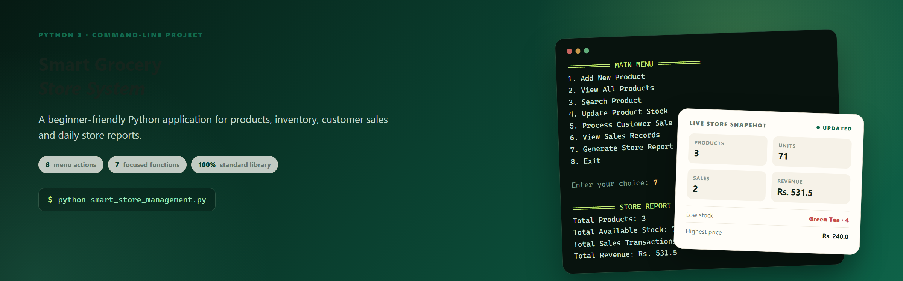

# Smart Grocery Store Management System

**Week 01 – Python Basics · Menu-driven command-line project**

A beginner-friendly Python application for managing grocery store products, inventory, customer sales and daily store reports. It runs entirely in the terminal and uses only the Python standard library.

| Interface | File | Purpose |
|---|---|---|
| Python CLI | `smart_store_management.py` | The original application: add products, search the catalogue, update stock, record sales and generate a store report |
| Browser demo | `index.html` | The same workflow recreated in JavaScript with a live inventory and sales dashboard, ready for GitHub Pages |

---

## Table of contents

1. [Project structure](#1-project-structure)
2. [Overview of the application](#2-overview-of-the-application)
3. [Requirements and how to run](#3-requirements-and-how-to-run)
4. [Application flow](#4-application-flow)
5. [Data model](#5-data-model)
6. [Features in detail](#6-features-in-detail)
7. [Input validation and error handling](#7-input-validation-and-error-handling)
8. [Store report](#8-store-report)
9. [Sample session](#9-sample-session)
10. [Python concepts covered](#10-python-concepts-covered)
11. [Live browser demo](#11-live-browser-demo)
12. [Testing summary](#12-testing-summary)
13. [Test cases](#13-test-cases)
14. [Project checklist](#14-project-checklist)

---

## 1. Project structure

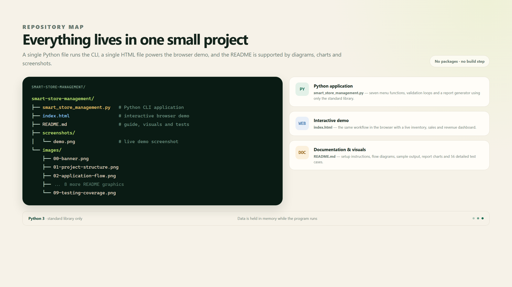

```text
smart-store-management/
├── smart_store_management.py   # Python CLI application
├── index.html                  # Interactive browser demo
├── README.md                   # Guide, diagrams and test cases
├── images/                     # Diagrams, charts and terminal captures used here
│   ├── 00-banner.png
│   ├── 01-project-structure.png
│   ├── 02-application-flow.png
│   ├── 03-data-model.png
│   ├── 04-features.png
│   ├── 05-validation.png
│   ├── 06-store-report.png
│   ├── 07-sample-session-sales.png
│   ├── 08-sample-session-report.png
│   ├── 09-python-concepts.png
│   └── 10-testing-coverage.png
└── screenshots/
    └── demo.png                # Screenshot of the browser demo
```

Both interfaces are self-contained. The Python program creates no data files: products and sales live in memory for the duration of a session, so restarting the program starts with an empty store.

---

## 2. Overview of the application

The Smart Grocery Store Management System is a menu-driven program that helps a small grocery store complete its daily operations from one terminal window.

- **Catalogue:** add products with an ID, name, category, price and stock quantity; view the full catalogue; search by ID or name.
- **Inventory:** add incoming stock or replace the quantity on hand.
- **Sales:** check stock availability, calculate the purchase total, deduct the sold units and keep a record of every completed sale.
- **Reporting:** count products, calculate available stock and revenue, list low-stock items and identify the highest and lowest priced products.

Every action returns to the main menu, so the user can keep working until they choose **8. Exit**. The application never writes to a database or a file, which keeps the project small enough to read in one sitting while still demonstrating a complete CRUD-style workflow.

---

## 3. Requirements and how to run

- **Python 3.8+** — no third-party packages are required.
- A terminal or command prompt.
- Any modern browser for the optional `index.html` demo.

### Run the Python application

From the project folder:

```bash
python smart_store_management.py
```

On some systems the command is `python3` instead of `python`.

The banner and main menu appear immediately:

```text
=============================================
       SMART GROCERY STORE SYSTEM
=============================================

========== MAIN MENU ==========
1. Add New Product
2. View All Products
3. Search Product
4. Update Product Stock
5. Process Customer Sale
6. View Sales Records
7. Generate Store Report
8. Exit

Enter your choice:
```

### Run the browser demo

Open `index.html` directly in a browser, or serve the folder:

```bash
python -m http.server 8000
```

Then open <http://localhost:8000>. Full demo instructions are in [section 11](#11-live-browser-demo).

### Verify the Python file compiles

```bash
python -m py_compile smart_store_management.py
```

No output means the file compiled successfully.

---

## 4. Application flow

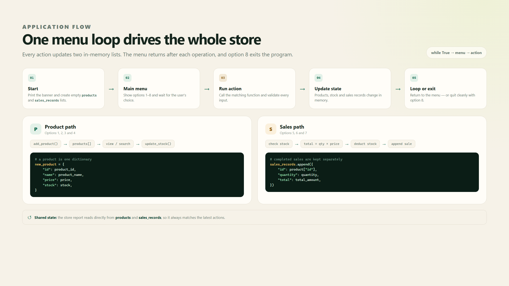

The program has one loop and seven focused functions:

```text
Start
  │
  ├── create empty products and sales_records lists
  │
  ▼
Main menu ──► choice 1–7 ──► run the matching function ──► back to the menu
  │
  └── choice 8 ──► thank-you message ──► exit
```

| Menu option | Function | What changes |
|---|---|---|
| `1. Add New Product` | `add_product()` | Appends one dictionary to `products` |
| `2. View All Products` | `view_products()` | Read-only |
| `3. Search Product` | `search_product()` | Read-only |
| `4. Update Product Stock` | `update_stock()` | Changes `product["stock"]` |
| `5. Process Customer Sale` | `process_sale()` | Reduces stock and appends to `sales_records` |
| `6. View Sales Records` | `view_sales()` | Read-only |
| `7. Generate Store Report` | `generate_report()` | Read-only |
| `8. Exit` | main loop | Prints a thank-you message and ends the program |

Each function validates its own input. Unknown menu choices print `Invalid choice! Please select between 1 and 8.` and the menu is displayed again, so a typo never ends the program.

---

## 5. Data model

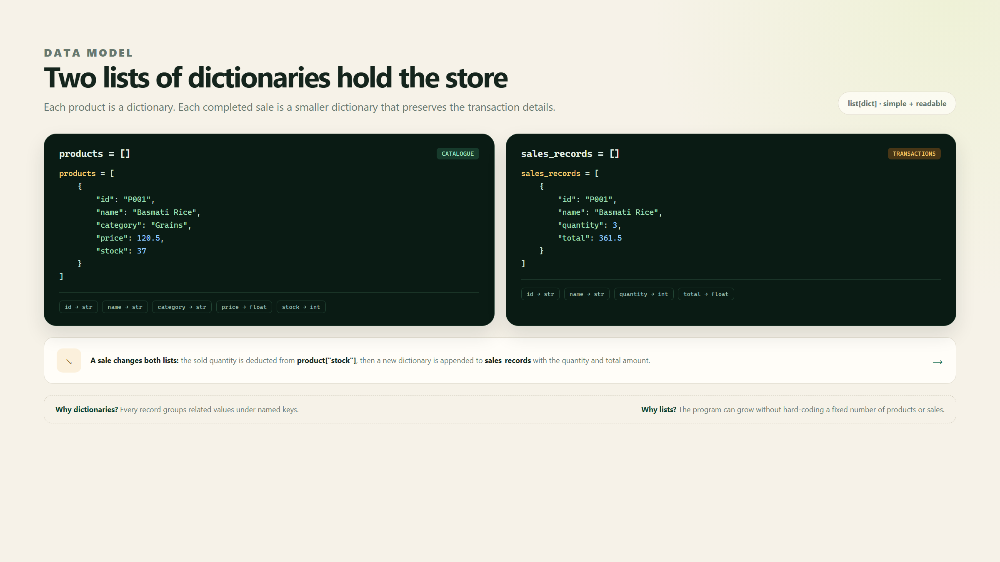

The store is held in two module-level lists.

### `products` — the catalogue

Each product is a dictionary with five named fields:

```python
products = [
    {
        "id": "P001",
        "name": "Basmati Rice",
        "category": "Grains",
        "price": 120.5,
        "stock": 37
    }
]
```

| Key | Type | Meaning |
|---|---|---|
| `id` | `str` | Unique product identifier; duplicate IDs are rejected |
| `name` | `str` | Display name used by search and reports |
| `category` | `str` | Product group such as Grains, Dairy or Beverages |
| `price` | `float` | Price per unit in rupees |
| `stock` | `int` | Units currently available |

### `sales_records` — the transaction log

Each completed sale is a smaller dictionary:

```python
sales_records = [
    {
        "id": "P001",
        "name": "Basmati Rice",
        "quantity": 3,
        "total": 361.5
    }
]
```

**A sale changes both lists.** The sold quantity is deducted from `product["stock"]`, then a new dictionary is appended to `sales_records`. Failed sales change neither list.

---

## 6. Features in detail

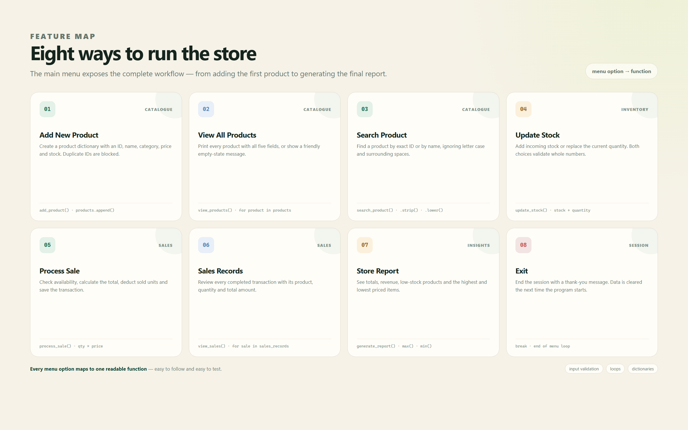

### 6.1 Add New Product

- Prints `----- Add New Product -----` and asks for the product ID.
- If the ID already exists, prints `Product ID already exists!` and returns immediately without asking for the remaining fields.
- Validates the price with `price.replace(".", "", 1).isdigit()` and converts it with `float()`.
- Validates stock with `stock.isdigit()` and converts it with `int()`.
- Builds a dictionary with `id`, `name`, `category`, `price` and `stock`, then appends it with `products.append(new_product)`.
- Prints `Product added successfully!`.

### 6.2 View All Products

- Prints every product in insertion order with all five fields.
- Shows `No products available.` when the list is empty.
- Always reflects stock changes made by earlier sales or restocks.

### 6.3 Search Product

- Accepts a product ID or a product name.
- Trims surrounding spaces with `.strip()`.
- Matches IDs exactly (case-sensitive) and names case-insensitively with `.lower()`.
- Prints `Product Found!` and the complete details for every match.
- Prints `Product not found.` when nothing matches.

### 6.4 Update Product Stock

- Finds a product by ID.
- Shows the current name and stock, then offers two choices:

| Choice | Action | Success message |
|---|---|---|
| `1` | Add the entered quantity to the current stock | `Stock added successfully!` |
| `2` | Replace the current stock with the entered quantity | `Stock updated successfully!` |

- Rejects non-digit input with `Invalid quantity!` and leaves stock unchanged.
- Prints `Updated Stock: <quantity>` after a valid choice.
- Prints `Product not found.` for an unknown ID.

### 6.5 Process Customer Sale

- Finds a product by ID and shows its name, available stock and price.
- Validates the purchase quantity as a positive whole number.
- Checks that the requested quantity does not exceed available stock.
- Calculates `total_amount = quantity * product["price"]`.
- Deducts the sold quantity from stock.
- Appends a sale record and prints:

```text
Sale completed successfully!
Product: Basmati Rice
Quantity Sold: 3
Total Amount: Rs. 361.5
Remaining Stock: 37
```

- An oversized request prints `Insufficient stock!` plus the available quantity; nothing is deducted and no record is stored.

### 6.6 View Sales Records

- Prints every completed transaction with product ID, product name, quantity sold and total amount.
- Shows `No sales records available.` when no sale has been completed.
- Transactions appear in the order they were recorded.

### 6.7 Generate Store Report

- Counts products and sums available stock.
- Counts sales transactions and sums revenue.
- Lists every product with stock below `5` units.
- Finds the highest and lowest prices with `max()` and `min()` and prints every product that shares those prices.
- Never changes the store data.

### 6.8 Exit

- Prints `Thank you for using Smart Grocery Store System!` and breaks the menu loop.
- Because data is stored only in memory, the next run begins with an empty catalogue and no sales.

---

## 7. Input validation and error handling

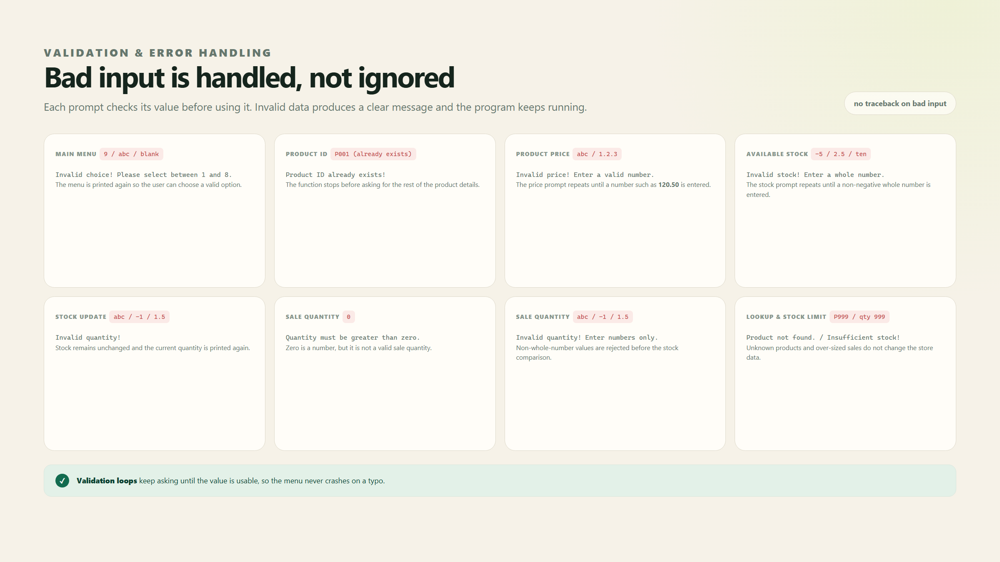

All prompts are checked before the value is used. Invalid input produces a friendly message and the program continues — no traceback is shown.

| Where | Invalid input | Message | What happens next |
|---|---|---|---|
| Main menu | `9`, `abc` or blank | `Invalid choice! Please select between 1 and 8.` | Menu is displayed again |
| Product ID | An ID that already exists | `Product ID already exists!` | Function returns without adding a product |
| Product price | `abc`, `1.2.3`, `-5` | `Invalid price! Enter a valid number.` | Price prompt repeats |
| Available stock | `ten`, `-5`, `2.5` | `Invalid stock! Enter a whole number.` | Stock prompt repeats |
| Stock update quantity | `abc`, `-1`, `1.5` | `Invalid quantity!` | Stock is unchanged and the updated stock is printed |
| Stock update choice | Anything except `1` or `2` | `Invalid choice!` | Stock is unchanged; no updated-stock line is printed |
| Sale quantity | `abc`, `-1`, `1.5` | `Invalid quantity! Enter numbers only.` | No sale is recorded |
| Sale quantity | `0` | `Quantity must be greater than zero.` | No sale is recorded |
| Sale quantity | More than available stock | `Insufficient stock!` and `Available Stock: <n>` | No sale is recorded |
| Product lookup | Unknown ID or name | `Product not found.` | No data is changed |

**Validation loops** keep asking until a usable value is entered:

```python
while True:
    price = input("Enter product price: ")

    if price.replace(".", "", 1).isdigit():
        price = float(price)
        break

    print("Invalid price! Enter a valid number.")
```

This means an accidental keypress never crashes the application and never leaves a half-created product or a partial sale behind.

---

## 8. Store report

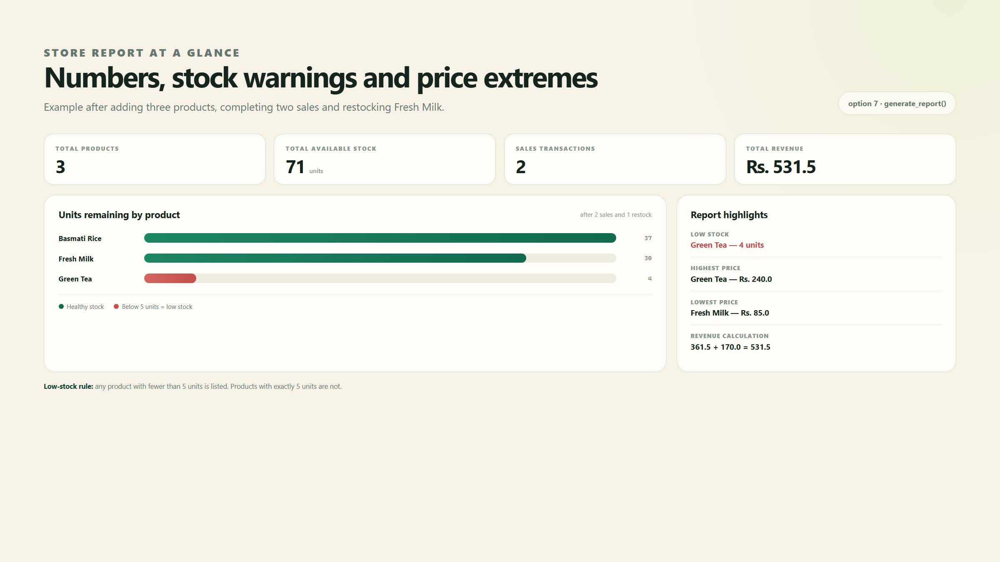

The report is generated by menu option **7** and reads directly from the current lists:

| Report field | How it is calculated |
|---|---|
| Total Products | `len(products)` |
| Total Available Stock | Accumulator over `product["stock"]` |
| Total Sales Transactions | `len(sales_records)` |
| Total Revenue | Accumulator over `sale["total"]` |
| Products with Low Stock | Every product whose `stock < 5` |
| Product with Highest Price | `max(product["price"] for product in products)` |
| Product with Lowest Price | `min(product["price"] for product in products)` |

### Example report

After adding Basmati Rice (40), Fresh Milk (12) and Green Tea (4), selling 3 units of rice, selling 2 units of milk and restocking milk with 20 units:

```text
========== STORE REPORT ==========
Total Products: 3
Total Available Stock: 71
Total Sales Transactions: 2
Total Revenue: Rs. 531.5

Products with Low Stock:
Green Tea - 4 units

Product with Highest Price:
Green Tea - Rs. 240.0

Product with Lowest Price:
Fresh Milk - Rs. 85.0
==================================
```

**Low-stock boundary:** a product with exactly `5` units is not reported. Only quantities below `5` are listed. If no product qualifies, the report prints `No products with low stock.`; if the catalogue is empty, it prints `No products available for price comparison.`

---

## 9. Sample session

The two captures below show one complete session: three products are added, two sales are completed, stock is updated, the report is generated and the program exits.

> Repeated menu blocks are shortened in the text transcript for readability.

### Part 1 — products, then two sales

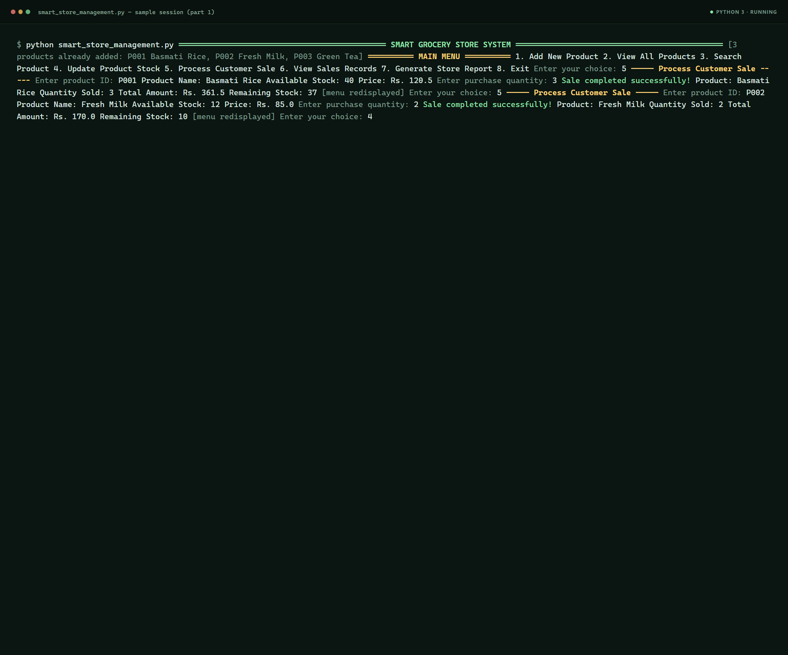

```text
$ python smart_store_management.py
=============================================
       SMART GROCERY STORE SYSTEM
=============================================

[3 products already added: P001 Basmati Rice, P002 Fresh Milk, P003 Green Tea]

========== MAIN MENU ==========
1. Add New Product
2. View All Products
3. Search Product
4. Update Product Stock
5. Process Customer Sale
6. View Sales Records
7. Generate Store Report
8. Exit

Enter your choice: 5

----- Process Customer Sale -----
Enter product ID: P001
Product Name: Basmati Rice
Available Stock: 40
Price: Rs. 120.5
Enter purchase quantity: 3

Sale completed successfully!
Product: Basmati Rice
Quantity Sold: 3
Total Amount: Rs. 361.5
Remaining Stock: 37

Enter your choice: 5

----- Process Customer Sale -----
Enter product ID: P002
Product Name: Fresh Milk
Available Stock: 12
Price: Rs. 85.0
Enter purchase quantity: 2

Sale completed successfully!
Product: Fresh Milk
Quantity Sold: 2
Total Amount: Rs. 170.0
Remaining Stock: 10

Enter your choice: 4
```

### Part 2 — restock, report and exit

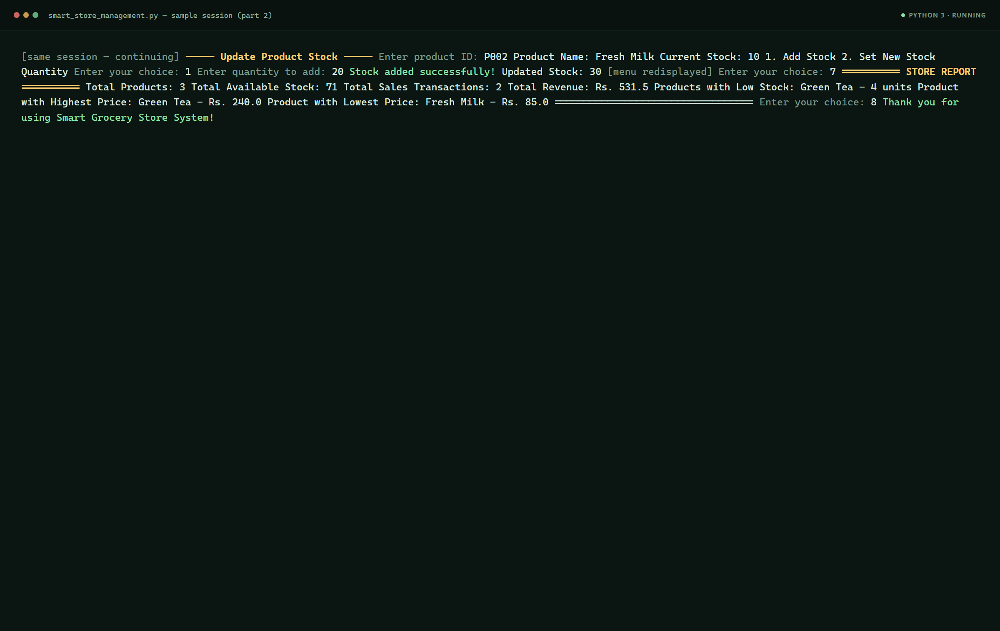

```text
----- Update Product Stock -----
Enter product ID: P002
Product Name: Fresh Milk
Current Stock: 10

1. Add Stock
2. Set New Stock Quantity
Enter your choice: 1
Enter quantity to add: 20
Stock added successfully!
Updated Stock: 30

Enter your choice: 7

========== STORE REPORT ==========
Total Products: 3
Total Available Stock: 71
Total Sales Transactions: 2
Total Revenue: Rs. 531.5

Products with Low Stock:
Green Tea - 4 units

Product with Highest Price:
Green Tea - Rs. 240.0

Product with Lowest Price:
Fresh Milk - Rs. 85.0
==================================

Enter your choice: 8

Thank you for using Smart Grocery Store System!
```

The report totals confirm the workflow: `37 + 30 + 4 = 71` units remain, and the two sales produced `361.5 + 170.0 = 531.5` rupees of revenue.

---

## 10. Python concepts covered

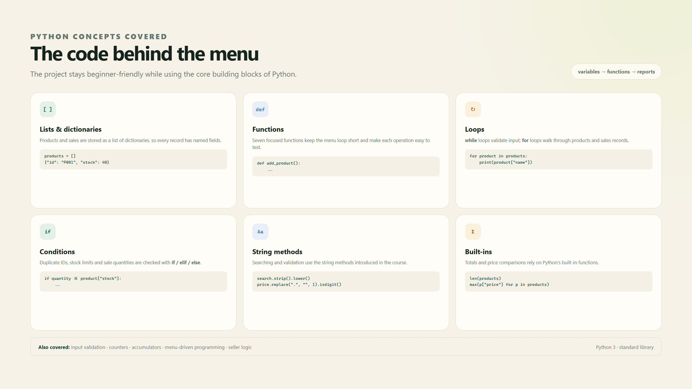

| Concept | Where it appears in the code |
|---|---|
| Variables and data types | IDs, names, prices, quantities and totals |
| Lists | `products` and `sales_records` |
| Dictionaries | One dictionary per product and one per completed sale |
| List of dictionaries | The structure of both data stores |
| Functions | Seven `def` functions, one per menu action |
| Parameters and return values | Input collection inside functions; `return` used to leave early |
| `for` loops | Walking through products and sales records |
| `while True` loops | Input validation for price and stock |
| `if` / `elif` / `else` | Menu routing, duplicate checks and stock decisions |
| Comparison and logical operators | `<=`, `<`, `==`, `or` and `and` |
| List methods | `append()` adds products and sales |
| String methods | `.strip()`, `.lower()`, `.isdigit()`, `.replace()` |
| Built-in functions | `len()`, `max()`, `min()`, `int()`, `float()` |
| Counters and accumulators | `total_stock` and `total_revenue` |
| Generator expressions | `max(... for product in products)` |
| Input validation | Every prompt checks its value before use |
| Menu-driven programming | The `while True` loop around the main menu |

A few representative snippets:

```python
# Case-insensitive name search, exact ID search
if (product["id"] == search_value or
        product["name"].lower() == search_value.lower()):
    ...

# Accumulate total stock
for product in products:
    total_stock = total_stock + product["stock"]

# Find price extremes
highest_price = max(product["price"] for product in products)
lowest_price = min(product["price"] for product in products)
```

---

## 11. Live browser demo

The repository includes an interactive browser demo in [`index.html`](index.html). It mirrors the Python CLI and adds a live dashboard that updates after every product, stock or sales operation.

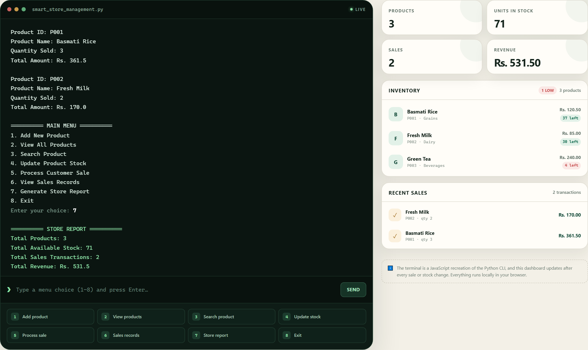

### Option 1: Open locally (fastest)

1. Download or clone this repository.
2. Open `index.html` in any modern browser (Chrome, Edge, Firefox or Safari).
3. Type a menu number in the terminal and press **Enter**, or click one of the menu shortcuts.

No Python installation or build step is required.

### Option 2: Serve the demo with Python

From the project folder, run:

```bash
python -m http.server 8000
```

Then open <http://localhost:8000> in your browser.

### Option 3: Publish the demo with GitHub Pages

1. Push the repository to GitHub.
2. Open **Settings → Pages**.
3. Under **Build and deployment**, choose **Deploy from a branch**.
4. Select the **main** branch and the **/ (root)** folder, then click **Save**.
5. After deployment, the demo will be available at `https://<username>.github.io/<repository>/`.

For this repository, the expected URL after enabling Pages is <https://hafsapixie.github.io/smart-store-management/>.

### Using the demo

- **Guided tour:** Click **Run guided demo** to watch the full workflow: add products, view the catalogue, record sales, update stock, view sales records and generate a store report.
- **Hands-on mode:** Type a menu number (`1`–`8`) in the terminal, or click a shortcut button below the terminal.
- **Live dashboard:** The panels show product count, units in stock, sales transactions, revenue, inventory levels and recent sales.
- **Sample data:** Four sample products are loaded automatically so the demo is ready to explore. Click **Reset demo** to restore them.
- **Session data:** Everything is stored in browser memory. Refreshing or resetting the demo clears any changes, just like restarting the Python program.

> **Note:** The browser demo is a JavaScript recreation of the CLI workflow so it can run on GitHub Pages without a Python server. The original Python implementation remains in `smart_store_management.py`.

---

## 12. Testing summary

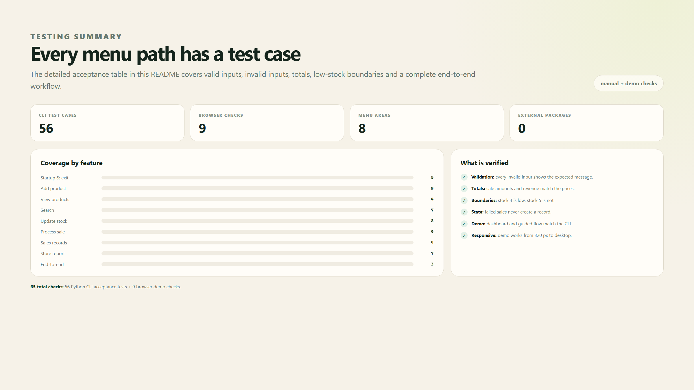

The complete acceptance suite is in [section 13](#13-test-cases). It contains **56 Python CLI test cases** (`TC-01`–`TC-56`) and **9 browser demo checks** (`BD-01`–`BD-09`).

| Area | What is verified |
|---|---|
| Startup and exit | Banner, menu, invalid choices, clean exit |
| Add product | Decimal prices, duplicate IDs, retries, zero stock, case-sensitive IDs |
| View products | Empty state, one product, multiple products, stock after a sale |
| Search | Exact ID, case-insensitive name, spaces, missing products, duplicate names |
| Update stock | Add stock, replace stock, invalid quantities, invalid sub-choice, zero stock |
| Process sale | Totals, exact-stock sale, insufficient stock, zero and non-numeric quantities |
| Sales records | Empty state, one sale, multiple sales, amounts matching prices |
| Store report | Empty store, totals, low-stock boundary, shared prices, non-mutating report |
| End-to-end | Complete workflow, restart clears data, no unhandled exceptions |
| Browser demo | Initial state, guided tour, shortcuts, validation, dashboard, reset, responsive layout |

Run the full suite manually with the steps in the next section. To check the Python file compiles:

```bash
python -m py_compile smart_store_management.py
```

---

## 13. Test cases

The following manual acceptance tests cover every menu option, validation path and edge case in `smart_store_management.py`. The browser demo should produce the same results.

### Test setup

- **Python version:** Python 3.x
- **Start the program:** `python smart_store_management.py`
- **Input notation:** `→` means press **Enter** after each value. For example, `1 → P100 → Sugar → Pantry → 60 → 25` means choose menu option 1, then enter those five values at the prompts.
- **Fresh program:** No products or sales records. Restart the program to reach this state.
- **Sample dataset:** Add the following products before running any test that mentions the sample dataset.

| Product ID | Name | Category | Price | Stock |
|---|---|---|---|---|
| `P001` | Basmati Rice | Grains | 120.50 | 40 |
| `P002` | Fresh Milk | Dairy | 85 | 12 |
| `P003` | Green Tea | Beverages | 240 | 4 |
| `P004` | Whole Wheat Bread | Bakery | 55.75 | 18 |

### 1. Startup, menu and exit

| ID | Test case | Input / steps | Expected result |
|---|---|---|---|
| TC-01 | Program starts correctly | Launch the program | A 45-character banner displays `SMART GROCERY STORE SYSTEM`, followed by the main menu with options 1–8 and the `Enter your choice:` prompt. |
| TC-02 | Invalid numeric menu choice | `9` | `Invalid choice! Please select between 1 and 8.` displays, then the main menu appears again. |
| TC-03 | Non-numeric menu choice | `abc` | The invalid-choice message displays and the menu is shown again. |
| TC-04 | Empty menu choice | Press Enter without typing anything | The invalid-choice message displays and the menu is shown again. |
| TC-05 | Exit the application | `8` | `Thank you for using Smart Grocery Store System!` displays and the program ends without showing the menu again. |

### 2. Add new product

| ID | Test case | Input / steps | Expected result |
|---|---|---|---|
| TC-06 | Add a valid product | `1 → P100 → Sugar → Pantry → 60 → 25` | `Product added successfully!` displays. The product is stored with price `60.0` and stock `25`. |
| TC-07 | Add a product with a decimal price | `1 → P101 → cooking oil → Pantry → 120.50 → 10` | The price is stored as `120.5` and `Product added successfully!` displays. |
| TC-08 | Reject a duplicate product ID | With the sample dataset, enter `1 → P001` | `Product ID already exists!` displays immediately. The program does not ask for the name and the product count does not change. |
| TC-09 | Retry after a non-numeric price | `1 → P102 → Salt → Spices → abc → 45.5 → 30` | `Invalid price! Enter a valid number.` displays, the price prompt repeats, and `45.5` is accepted. The product is added once. |
| TC-10 | Reject a malformed price | `1 → P103 → Flour → Baking → 1.2.3 → 75 → 10` | `Invalid price! Enter a valid number.` displays for `1.2.3`, then `75` is accepted. |
| TC-11 | Retry after a non-numeric stock | `1 → P104 → Oats → Breakfast → 40 → ten → 20` | `Invalid stock! Enter a whole number.` displays, the stock prompt repeats, and `20` is accepted. |
| TC-12 | Reject negative or decimal stock | `1 → P105 → Coffee → Beverages → 300 → -5 → 2.5 → 10` | The invalid-stock message displays twice, then `10` is accepted. |
| TC-13 | Accept zero stock | `1 → P106 → Limited Item → Test → 10 → 0` | The product is added successfully with stock `0`. It should appear under low-stock products in the report. |
| TC-14 | Product IDs are case-sensitive | With the sample dataset, add `p001` with valid details | The product is accepted because `p001` and `P001` are treated as different IDs. This documents the current behavior. |

### 3. View all products

| ID | Test case | Input / steps | Expected result |
|---|---|---|---|
| TC-15 | View an empty product list | Fresh program → `2` | `----- Available Products -----` and `No products available.` display. |
| TC-16 | View one product | Add a product, then choose `2` | The product ID, name, category, price and available stock all display correctly. |
| TC-17 | View multiple products | Add the sample dataset, then choose `2` | All four products display in insertion order, with a blank line between products. |
| TC-18 | Stock reflects completed sales | With the sample dataset, sell 3 units of `P001`, then choose `2` | Basmati Rice displays `Available Stock: 37`. |

### 4. Search product

| ID | Test case | Input / steps | Expected result |
|---|---|---|---|
| TC-19 | Search by exact product ID | With the sample dataset, choose `3`, then enter `P002` | `Product Found!` and all details for Fresh Milk display. |
| TC-20 | Search by name case-insensitively | Choose `3`, then enter `fresh milk` | Fresh Milk is found. |
| TC-21 | Search with surrounding spaces | Choose `3`, then enter `  Fresh Milk  ` | The input is trimmed and Fresh Milk is found. |
| TC-22 | Search for a missing product | Choose `3`, then enter `Mango` | `Product not found.` displays. |
| TC-23 | Search with an empty value | Choose `3`, then press Enter | `Product not found.` displays. |
| TC-24 | Multiple products with the same name | Add two products with different IDs but the same name, then search that name | Details for both matching products display. |
| TC-25 | Product ID search is case-sensitive | With the sample dataset, choose `3`, then enter `p001` | `Product not found.` displays because ID matching is case-sensitive. |

### 5. Update product stock

| ID | Test case | Input / steps | Expected result |
|---|---|---|---|
| TC-26 | Add stock using option 1 | With the sample dataset, choose `4 → P002 → 1 → 8` | `Stock added successfully!` and `Updated Stock: 20` display. |
| TC-27 | Replace stock using option 2 | With the sample dataset, choose `4 → P001 → 2 → 100` | `Stock updated successfully!` and `Updated Stock: 100` display. |
| TC-28 | Invalid quantity when adding stock | Choose `4 → P002 → 1 → abc` | `Invalid quantity!` displays, followed by `Updated Stock: 12` because the stock is unchanged. |
| TC-29 | Negative or decimal quantity | Choose `4 → P002 → 2 → -1` or `4 → P002 → 2 → 1.5` | `Invalid quantity!` and `Updated Stock: 12` display. |
| TC-30 | Invalid update sub-choice | Choose `4 → P002 → 3` | `Invalid choice!` displays. The `Updated Stock` line is not printed and stock remains `12`. |
| TC-31 | Update an unknown product | Choose `4 → P999` | `Product not found.` displays and no product is changed. |
| TC-32 | Set stock to zero | Choose `4 → P002 → 2 → 0` | `Stock updated successfully!` and `Updated Stock: 0` display. The product becomes a low-stock item. |
| TC-33 | Updated stock persists | Add stock to `P002`, then choose `2` | The updated stock quantity is shown in the product listing. |

### 6. Process customer sale

| ID | Test case | Input / steps | Expected result |
|---|---|---|---|
| TC-34 | Complete a valid sale | With the sample dataset, choose `5 → P001 → 3` | Total is `Rs. 361.5`, remaining stock is `37`, and one sales record is created. |
| TC-35 | Sell the exact available stock | Choose `5 → P003 → 4` | Total is `Rs. 960.0`, remaining stock is `0`, and the sale is recorded. |
| TC-36 | Reject an insufficient-stock sale | Choose `5 → P002 → 13` | `Insufficient stock!` and `Available Stock: 12` display. Stock and sales records do not change. |
| TC-37 | Reject a zero quantity | Choose `5 → P001 → 0` | `Quantity must be greater than zero.` displays and no sale is recorded. |
| TC-38 | Reject a non-numeric quantity | Choose `5 → P001 → abc` | `Invalid quantity! Enter numbers only.` displays and no sale is recorded. |
| TC-39 | Reject a negative or decimal quantity | Choose `5 → P001 → -1` or `5 → P001 → 1.5` | The invalid-quantity message displays and no sale is recorded. |
| TC-40 | Calculate a decimal total correctly | Choose `5 → P004 → 2` | Total is `Rs. 111.5`, remaining stock is `16`, and the sale is recorded. |
| TC-41 | Sell an unknown product | Choose `5 → P999` | `Product not found.` displays and no sale is recorded. |
| TC-42 | Failed sales are not stored | Attempt an insufficient-stock sale, then choose `6` | The failed sale does not appear in the sales records. |

### 7. Sales records

| ID | Test case | Input / steps | Expected result |
|---|---|---|---|
| TC-43 | View empty sales records | Fresh program → `6` | `----- Sales Records -----` and `No sales records available.` display. |
| TC-44 | View one completed sale | Sell 3 units of `P001`, then choose `6` | Product ID, name, quantity sold (`3`) and total amount (`Rs. 361.5`) display. |
| TC-45 | View multiple sales in order | Complete two sales, then choose `6` | Both sales display in the order they were completed with the correct quantities and totals. |
| TC-46 | Sale totals match product prices | Sell 2 units of `P004`, then choose `6` | The recorded total is `Rs. 111.5`, matching `2 × 55.75`. |

### 8. Generate store report

| ID | Test case | Input / steps | Expected result |
|---|---|---|---|
| TC-47 | Generate an empty-store report | Fresh program → `7` | Totals are `0`; transactions and revenue are `0`; the report shows `No products with low stock.` and `No products available for price comparison.` |
| TC-48 | Report with products but no sales | Add the sample dataset, then choose `7` | Total products `4`, total stock `74`, transactions `0`, revenue `Rs. 0`. Low stock: Green Tea – 4 units. Highest price: Green Tea – Rs. 240.0. Lowest price: Whole Wheat Bread – Rs. 55.75. |
| TC-49 | Low-stock boundary is below 5 | Add one product with stock `5` and another with stock `4`, then choose `7` | Only products with stock below `5` are listed. The product with stock `5` is not listed. |
| TC-50 | Report with no low-stock products | Set every product's stock to `5` or more, then choose `7` | `No products with low stock.` displays. |
| TC-51 | Report totals after sales | With the sample dataset, sell 3 units of `P001` and 2 units of `P002`, then choose `7` | Total products `4`, total stock `69`, transactions `2`, revenue `Rs. 531.5`. Low stock: Green Tea – 4 units. Highest price: Green Tea – Rs. 240.0. Lowest price: Whole Wheat Bread – Rs. 55.75. |
| TC-52 | Multiple products share a price | Add two products with the same highest or lowest price, then choose `7` | Both matching product names display under the relevant highest- or lowest-price heading. |
| TC-53 | Report does not modify data | Run the report twice, then choose `2` and `6` | Product stock, sales records and totals remain unchanged. |

### 9. End-to-end workflow

| ID | Test case | Input / steps | Expected result |
|---|---|---|---|
| TC-54 | Complete store workflow | Use this input sequence:<br>`1 → P001 → Basmati Rice → Grains → 120.50 → 40`<br>`1 → P002 → Fresh Milk → Dairy → 85 → 12`<br>`1 → P003 → Green Tea → Beverages → 240 → 4`<br>`2`<br>`3 → Fresh Milk`<br>`4 → P002 → 1 → 8`<br>`5 → P001 → 3`<br>`5 → P003 → 4`<br>`6`<br>`7`<br>`8` | Final state: 3 products, stock totals `37 + 20 + 0 = 57`, 2 sales transactions, revenue `Rs. 1321.5`, low stock Green Tea – 0 units, highest price Green Tea – Rs. 240.0, lowest price Fresh Milk – Rs. 85.0. The program exits with the thank-you message. |
| TC-55 | Restarting clears all data | Complete one or more operations, choose `8`, start the program again, then choose `2` and `6` | `No products available.` and `No sales records available.` display because data is stored only in memory. |
| TC-56 | No unhandled exceptions | Repeatedly use each menu option with valid and invalid inputs | No Python traceback appears. Every invalid input produces a friendly message and the program continues. |

### 10. Browser demo checks

| ID | Test case | Steps | Expected result |
|---|---|---|---|
| BD-01 | Initial demo state | Open `index.html` | The terminal shows the banner and main menu. The dashboard shows 4 products, 74 units, 0 sales and `Rs. 0.00` revenue. |
| BD-02 | Guided demo completes | Click **Run guided demo** and wait | The terminal runs add, view, sale, stock-update, sales-record and report actions. The final dashboard shows 3 products, 71 units, 2 sales and `Rs. 531.50` revenue. |
| BD-03 | Menu shortcuts work | Click shortcut `2` | The terminal displays all products, matching the Python CLI output. |
| BD-04 | Validation messages match | Try an invalid price, stock quantity, sale quantity and unknown product ID | The same validation messages as the Python program display, and the demo continues without errors. |
| BD-05 | Dashboard updates after a sale | Process a sale for `P001` with quantity `3` | Stock decreases by 3, sales increase by 1, revenue increases by `Rs. 361.50`, and the new sale appears in Recent Sales. |
| BD-06 | Reset restores sample data | Make changes, then click **Reset demo** | The terminal clears and restarts with 4 sample products, 74 units, 0 sales and `Rs. 0.00` revenue. |
| BD-07 | Stop guided demo | Start the guided demo, then click **Stop demo** | The demo stops, sample data is restored, and the terminal input becomes enabled. |
| BD-08 | Responsive layout | View at 320 px, 390 px, 768 px and 1440 px widths | No horizontal page scrolling appears; the terminal, menu shortcuts and dashboard remain usable. |
| BD-09 | No browser errors | Perform all terminal actions with the browser console open | No JavaScript errors appear. |

### Test completion checklist

- [ ] TC-01 to TC-56 pass for `smart_store_management.py`.
- [ ] BD-01 to BD-09 pass for `index.html`.
- [ ] `python -m py_compile smart_store_management.py` completes with no errors.
- [ ] No Python traceback or browser console error appears.
- [ ] All totals, stock levels, revenue and low-stock results match the expected values.

---

## 14. Project checklist

- [x] Menu-driven Python application with options 1–8
- [x] Products stored as a list of dictionaries with ID, name, category, price and stock
- [x] Duplicate product IDs rejected
- [x] Product listing and case-insensitive name search
- [x] Stock updates by adding or replacing quantities
- [x] Sales validated against available stock
- [x] Completed sales stored separately with quantity and total
- [x] Store report with totals, revenue, low-stock items and price extremes
- [x] Friendly validation messages for every invalid input
- [x] Read-only, in-memory data model documented
- [x] Interactive browser demo in `index.html`
- [x] README with diagrams, charts, sample session and screenshots
- [x] 56 Python CLI acceptance tests and 9 browser demo checks

---

*Author: Hafsa Naseer | Week 01: Python Basics – Smart Grocery Store Management System*
